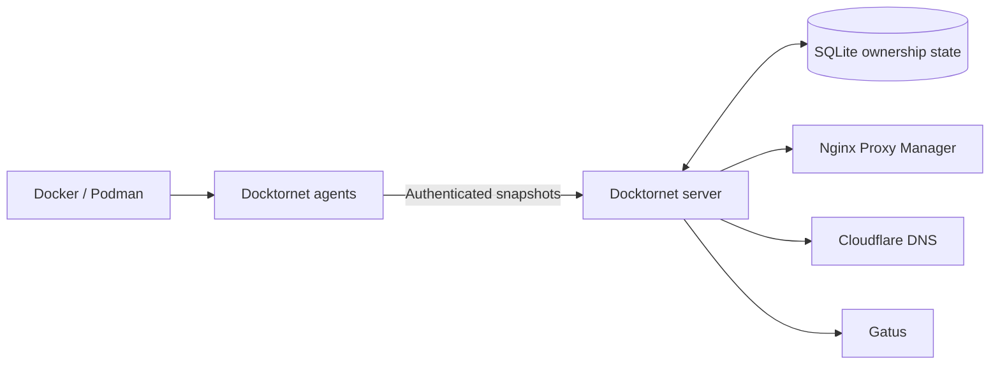

# Docktornet

Docktornet is a declarative infrastructure reconciler for self-hosted services.
Containers describe reverse-proxy, DNS, and monitoring intent through
`docktornet.*` labels; Docktornet discovers that intent and reconciles Nginx
Proxy Manager, Cloudflare DNS, and Gatus from one source of truth.

## Status

**v1.0.0 is complete.** The agent/server architecture, SQLite-backed ownership,
Nginx Proxy Manager, Cloudflare DNS, Gatus, full resync, health endpoint,
deployment manifests, and cutover runbook are implemented.

## Why Docktornet Is Technically Interesting

- **Declarative control plane:** infrastructure follows container labels instead
  of separately maintained proxy, DNS, and monitoring configuration.
- **Distributed discovery:** lightweight agents enumerate Docker or Podman
  sockets on each host and send authenticated snapshots to a central server.
- **Stateful reconciliation:** SQLite tracks snapshots and resource ownership so
  the server can converge external systems and remove resources it owns when
  their labels disappear.
- **Failure-aware integrations:** reconciliation includes request timeouts,
  no-op detection, Cloudflare rate-limit handling, an NPM circuit breaker, and
  atomic Gatus configuration writes.
- **Guarded adoption:** dry-run is the default and existing resources are only
  adopted when explicitly enabled.
- **Small deployment shape:** three Rust crates produce an agent and a central
  server, with Compose manifests for each role.



## Architecture And Operations

- `docktornet-core` parses labels and defines the shared snapshot model.
- `docktornet-agent` discovers containers and pushes host snapshots.
- `docktornet-server` stores desired state and reconciles external providers.
- [Design specification](docs/superpowers/specs/2026-05-21-docktornet-design.md)
- [Deployment guide](docs/deployment.md)
- [v1 cutover runbook](docs/runbooks/v1-cutover.md)

## Quick start (local dev)

```bash
just run-server  # in one terminal, with server.env loaded
just run-agent   # in another, with agent.env loaded
```

## Container labels

Docktornet reconciles state from Docker/Podman container labels. All keys are
prefixed with `docktornet.`; any other labels are ignored. Containers with no
`docktornet.*` labels are skipped entirely.

Boolean fields accept `true`/`1`/`yes` or `false`/`0`/`no`.

### Nginx Proxy Manager (`docktornet.npm.<index>.*`)

`<index>` is an integer (`0`, `1`, …) so a single container can publish
multiple proxy hosts.

To route **several public domains to the same upstream as one NPM entry**, give
`host` a comma-separated list (e.g. `app.example.com,app.mydomain.org`). All
domains share that entry's port, scheme, SSL and certificate. Use a separate
`<index>` only when you need a different upstream or settings.

> **Certificates:** NPM stores one certificate per proxy host. Cert resolution
> matches on the first listed domain that has a cert, and adoption of an
> existing host matches on any of the listed domains. If your domains need
> *different* certificates, use a separate `<index>` per domain instead. Domains
> covered by a single wildcard/SAN cert (the usual reason to group them) work as
> one entry.

| Label | Required | Type | Default | Example | Notes |
|-------|----------|------|---------|---------|-------|
| `docktornet.npm.<index>.host` | yes | string (comma-separated) | — | `flowsync.example.com` | One or more public hostnames (FQDN) on a single proxy host. Comma-separated for multiple domains. |
| `docktornet.npm.<index>.port` | yes | u16 | — | `8080` | Upstream port. |
| `docktornet.npm.<index>.scheme` | yes | `http` \| `https` | — | `http` | Upstream scheme. |
| `docktornet.npm.<index>.ssl` | yes | bool | — | `true` | Enable SSL on the proxy host. |
| `docktornet.npm.<index>.hsts` | no | bool | `true` when `ssl` is on | `false` | Enable HSTS. Forced off when `ssl` is off. |
| `docktornet.npm.<index>.hsts_subdomains` | no | bool | `true` when HSTS is on | `false` | Apply HSTS to subdomains. Forced off when HSTS is off. |
| `docktornet.npm.<index>.http2` | no | bool | `true` when `ssl` is on | `true` | Enable HTTP/2 support. Forced off when `ssl` is off. |
| `docktornet.npm.<index>.block_exploits` | no | bool | `true` | `false` | Block common exploits. |
| `docktornet.npm.<index>.websockets` | no | bool | `true` | `false` | Enable Websocket support. |
| `docktornet.npm.<index>.cert_id` | no | u32 | unset | `7` | Existing NPM certificate ID. |

### Cloudflare DNS (`docktornet.cf.dns.*`)

A single DNS record per container (not indexed).

| Label | Required | Type | Default | Example | Notes |
|-------|----------|------|---------|---------|-------|
| `docktornet.cf.dns.name` | yes | string | — | `flowsync` | Record name (zone is appended automatically). |
| `docktornet.cf.dns.target` | yes | string | — | `home.example.com` | CNAME target (must be a full domain). |
| `docktornet.cf.dns.proxied` | yes | bool | — | `true` | Whether the record is proxied through Cloudflare. |

### Gatus monitors (`docktornet.gatus.<index>.*`)

`<index>` is an integer so a single container can define multiple monitors.

| Label | Required | Type | Default | Example | Notes |
|-------|----------|------|---------|---------|-------|
| `docktornet.gatus.<index>.url` | yes | string | — | `https://flowsync.example.com` | Endpoint to monitor. |
| `docktornet.gatus.<index>.interval` | yes | string | — | `30s` | Check interval. |
| `docktornet.gatus.<index>.conditions` | no | string | `[STATUS] == 200` | `[STATUS] == 200, [RESPONSE_TIME] < 500` | Comma-separated condition list. |
| `docktornet.gatus.<index>.group` | no | string | host/machine id | `media` | Gatus dashboard group. Defaults to the machine this container runs on. |
| `docktornet.gatus.<index>.name` | no | string | container name | `Homepage` | Display name shown in alerts/dashboard. Defaults to the container name; colliding defaults get a ` <index>` suffix. |
| `docktornet.gatus.<index>.telegram` | no | bool | `true` | `false` | Emit a Gatus `custom` alert (used for Telegram). |

### Example

A minimal `compose.yml` fragment for a container that publishes one proxy
host, one DNS record, and three monitors (public, internal, and direct IP):

```yaml
services:
  flowsync:
    image: example/flowsync:latest
    labels:
      # Nginx Proxy Manager
      docktornet.npm.0.host: flowsync.example.com
      docktornet.npm.0.port: "8080"
      docktornet.npm.0.scheme: http
      docktornet.npm.0.ssl: "true"

      # Cloudflare DNS
      docktornet.cf.dns.name: flowsync
      docktornet.cf.dns.target: home.example.com
      docktornet.cf.dns.proxied: "true"

      # Gatus monitors
      docktornet.gatus.0.url: https://flowsync.example.com
      docktornet.gatus.0.interval: 30s
      docktornet.gatus.1.url: https://flowsync.home.local
      docktornet.gatus.1.interval: 30s
      docktornet.gatus.2.url: http://192.168.1.42:8080
      docktornet.gatus.2.interval: 60s
      docktornet.gatus.2.telegram: "false"
```

## Development

The `Justfile` exposes the standard formatting, linting, checking, testing, and
local run commands. Run `just` to list them.

## Licence

Docktornet is licensed under the GNU Affero General Public License v3.0 or
later. See [LICENSE](LICENSE).
