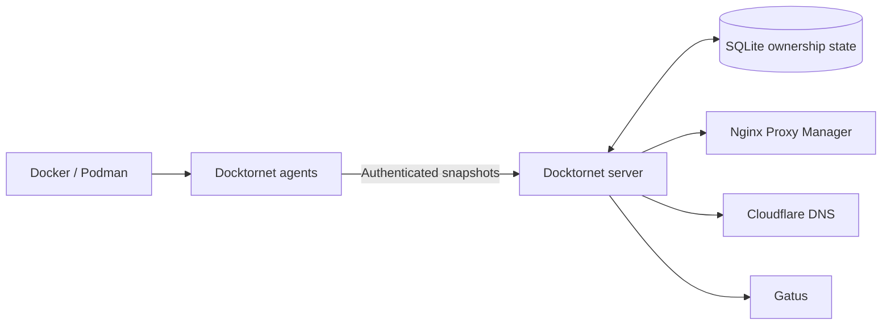

# Docktornet

Docktornet is a declarative infrastructure reconciler for self-hosted services.
Containers describe reverse-proxy, DNS, and monitoring intent through
`docktornet.*` labels; Docktornet discovers that intent and reconciles Nginx
Proxy Manager, Cloudflare DNS, and Gatus from one source of truth.

## Status

**v1.1.0 is the current stable release.** The agent/server architecture,
SQLite-backed ownership, Nginx Proxy Manager, Cloudflare DNS, Gatus, full
resync, health endpoint, deployment manifests, and cutover runbook are
implemented. See the [v1.1.0 release notes](https://github.com/BattermanZ/DocktorNet/releases/tag/v1.1.0)
for the multi-domain NPM workflow and post-v1 reliability and security changes.

## Why Docktornet Is Technically Interesting

- **Declarative control plane:** infrastructure follows container labels instead
  of separately maintained proxy, DNS, and monitoring configuration.
- **Distributed discovery:** lightweight agents enumerate Docker or Podman
  sockets on each host and send authenticated snapshots to a central server.
- **Stateful reconciliation:** SQLite tracks snapshots and resource ownership so
  the server can converge external systems and remove resources it owns after
  their labels disappear and the restart grace period expires.
- **Failure-aware integrations:** reconciliation includes request timeouts,
  no-op detection, Cloudflare rate-limit handling, an NPM circuit breaker, and
  atomic Gatus configuration writes.
- **Ownership markers:** every NPM proxy host and Cloudflare record Docktornet
  manages names its owning service, so a lost database does not lose ownership.
  Dry-run is the default, and Docktornet adopts an unmarked resource only when
  you enable it.
- **Small deployment shape:** three Rust crates produce an agent and a central
  server, with Compose manifests for each role.



## Architecture And Operations

- `docktornet-core` parses labels and defines the shared snapshot model.
- `docktornet-agent` discovers containers and pushes host snapshots.
- `docktornet-server` stores desired state and reconciles external providers.
- [Design specification](docs/superpowers/specs/2026-05-21-docktornet-design.md)
- [Deployment guide](docs/deployment.md)
- [v1 cutover runbook](docs/runbooks/v1-cutover.md)
- [v1.1.0 release notes](https://github.com/BattermanZ/DocktorNet/releases/tag/v1.1.0)

The public `GET /healthz` response contains liveness status and server time.
Send the configured bearer token to include agent inventory and versions: the
server's `version`, and each agent's `agent_version` (`null` for an agent that
predates version reporting). Unauthenticated callers do not receive machine
IDs, forwarding addresses, last-seen times or versions. The server logs a
warning once per change when an agent's version differs from its own.

The server refuses a relative `DOCKTORNET_DB_PATH`, and inside a container it
refuses a database on the container's own filesystem. The
[deployment guide](docs/deployment.md#the-database-path) has the rules and the
override.

### Resource removal lifecycle

When a service disappears from an agent snapshot, Docktornet preserves its
managed NPM proxy hosts, Cloudflare DNS record, and Gatus configuration for a
five-minute restart grace period. If the service returns, its stored external
resource mappings are restored. If it remains absent, Docktornet removes the
owned resources within about a minute of the grace period ending; failed
external deletions are persisted and retried on that same minute timer. Gatus
picks up a removed monitor on its next config check, every 30 seconds.

### Ownership markers

The SQLite database is Docktornet's working copy of what it owns. Each managed
resource also carries an ownership marker naming the service ID
(`<machine>/<container>`) that owns it:

- NPM proxy host: the `docktornet` key in the host's `meta`, holding
  `{"service_id": "<machine>/<container>", "npm_index": <n>}`. Docktornet
  merges this key into `meta` and leaves every other key alone, including
  NPM's own and any set in the NPM UI.
- Cloudflare DNS record: the comment `docktornet:<machine>/<container>`. If
  that would be longer than 100 characters, Docktornet leaves the comment empty
  and logs a warning naming the service.

A missing or wrong marker counts as drift, and the next full resync rewrites
it. When a service has no stored mapping, Docktornet first looks for a resource
marked with its service ID and adopts it, with no flag needed. That is how it
recovers ownership after the database is lost. Only then does it create one. A
marked host that serves domains the labels no longer list loses them on the
next update, as a label edit would.

Hostname adoption, enabled by `DOCKTORNET_ADOPT_EXISTING=true`, still takes
over an existing resource whose hostname matches the labels. It now adopts
only unmarked resources and writes the marker when it does. A resource whose
marker names another service is never adopted: the reconcile fails and logs
both the owner and the service that wanted it.

Docktornet deletes only what a stored mapping or pending removal points to. It
never deletes a marked resource that has no mapping, and dry-run writes no
markers. See [ADR 0001](docs/adr/0001-ownership-markers.md) for the format.

To find orphans, run `docker exec docktornet-server docktornet-server audit`.
It prints, as JSON, the resources no mapping points to and the mappings whose
resource is gone or unmarked. The
[deployment guide](docs/deployment.md#auditing-ownership) explains the output.

The first full resync after upgrading to a version with markers runs at startup
and updates every mapped proxy host and DNS record once to write its marker.
NPM reloads nginx on each proxy host update, so expect one reload per proxy
host on that pass. The [deployment guide](docs/deployment.md#ownership-markers-and-adoption)
has the details.

## Quick start (local dev)

```bash
cp server.env.example server.env  # then fill it in
cp agent.env.example agent.env    # then fill it in
just run-server  # in one terminal, loads ./server.env
just run-agent   # in another, loads ./agent.env
```

`DOCKTORNET_SECRET` must match in both files, be at least 32 characters and
not contain `changeme`; generate one with `openssl rand -hex 32`. Agent
`DOCKTORNET_POLL_INTERVAL` values must be at least one second. See the
[deployment guide](docs/deployment.md) for the complete environment-variable
reference.

## Container labels

Docktornet reconciles state from Docker/Podman container labels. All keys are
prefixed with `docktornet.`; any other labels are ignored. Containers with no
`docktornet.*` labels are skipped entirely.

Boolean fields accept `true`/`1`/`yes` or `false`/`0`/`no`.

### Nginx Proxy Manager (`docktornet.npm.<index>.*`)

`<index>` is an integer (`0`, `1`, …) so a single container can publish
multiple proxy hosts.

To route **several public domains to the same upstream as one NPM entry**, give
`host` a comma-separated list (e.g. `app.example.com,app.mydomain.org`). All
domains share that entry's port, scheme, SSL and certificate. Use a separate
`<index>` only when you need a different upstream or settings.

> **Certificates and adoption:** NPM stores one certificate per proxy host. When
> `cert_id` is omitted, automatic resolution selects a certificate only when it
> covers every listed domain (exactly or through its wildcard/SAN names). If no
> certificate covers every domain and `ssl=true`, Docktornet refuses to publish
> the host instead of silently downgrading it to HTTP. An explicit `cert_id` is
> used as configured, so ensure it covers every domain. Hostname adoption can
> find an existing host through any listed domain, but is refused if the update
> would drop domains that are not present in the Docktornet labels. Marker
> adoption is not refused: the host is already Docktornet's. Use a separate
> `<index>` when domains require different certificates or settings.

| Label | Required | Type | Default | Example | Notes |
|-------|----------|------|---------|---------|-------|
| `docktornet.npm.<index>.host` | yes | string (comma-separated) | — | `flowsync.example.com` | One or more public hostnames (FQDN) on a single proxy host. Comma-separated for multiple domains. |
| `docktornet.npm.<index>.port` | yes | u16 | — | `8080` | Upstream port. |
| `docktornet.npm.<index>.scheme` | yes | `http` \| `https` | — | `http` | Upstream scheme. |
| `docktornet.npm.<index>.ssl` | yes | bool | — | `true` | Enable SSL on the proxy host. |
| `docktornet.npm.<index>.hsts` | no | bool | `true` when `ssl` is on | `false` | Enable HSTS. Forced off when `ssl` is off. |
| `docktornet.npm.<index>.hsts_subdomains` | no | bool | `true` when HSTS is on | `false` | Apply HSTS to subdomains. Forced off when HSTS is off. |
| `docktornet.npm.<index>.http2` | no | bool | `true` when `ssl` is on | `true` | Enable HTTP/2 support. Forced off when `ssl` is off. |
| `docktornet.npm.<index>.block_exploits` | no | bool | `true` | `false` | Block common exploits. |
| `docktornet.npm.<index>.websockets` | no | bool | `true` | `false` | Enable Websocket support. |
| `docktornet.npm.<index>.cert_id` | no | u32 | unset | `7` | Existing NPM certificate ID. |

### Cloudflare DNS (`docktornet.cf.dns.*`)

A single DNS record per container (not indexed).

| Label | Required | Type | Default | Example | Notes |
|-------|----------|------|---------|---------|-------|
| `docktornet.cf.dns.name` | yes | string | — | `flowsync` | Record name (zone is appended automatically). |
| `docktornet.cf.dns.target` | yes | string | — | `home.example.com` | CNAME target (must be a full domain). |
| `docktornet.cf.dns.proxied` | yes | bool | — | `true` | Whether the record is proxied through Cloudflare. |

### Gatus monitors (`docktornet.gatus.<index>.*`)

`<index>` is an integer so a single container can define multiple monitors.

| Label | Required | Type | Default | Example | Notes |
|-------|----------|------|---------|---------|-------|
| `docktornet.gatus.<index>.url` | yes | string | — | `https://flowsync.example.com` | Endpoint to monitor. |
| `docktornet.gatus.<index>.interval` | yes | string | — | `30s` | Check interval. |
| `docktornet.gatus.<index>.conditions` | no | string | `[STATUS] == 200` | `[STATUS] == 200, [RESPONSE_TIME] < 500` | Comma-separated condition list. |
| `docktornet.gatus.<index>.group` | no | string | host/machine id | `media` | Gatus dashboard group. Defaults to the machine this container runs on. |
| `docktornet.gatus.<index>.name` | no | string | container name | `Homepage` | Display name shown in alerts/dashboard. Defaults to the container name; colliding defaults get a ` <index>` suffix. |
| `docktornet.gatus.<index>.telegram` | no | bool | `true` | `false` | Emit a Gatus `custom` alert (used for Telegram). |
| `docktornet.gatus.<index>.severity` | no | `critical`, `warning` or `info` | `warning` | `critical` | How urgent this endpoint's alerts are. Written to the classification map only; the Gatus config does not change. |
| `docktornet.gatus.<index>.area` | no | `core`, `backups`, `storage`, `network`, `apps`, `deploys` or `agents` | `apps` | `backups` | Which part of the estate this endpoint watches. Written to the classification map only. |

Values are lowercase and matched exactly. An unknown `severity` or `area`
drops that monitor and logs a warning naming it, the same as any other
malformed `gatus` label. It never falls back to the default, so a typo cannot
quietly demote a critical endpoint. Every other monitor on the container is
still published.

### Gatus classification map

Next to the per-service Gatus files, the server writes
`docktornet-classification.json` in `DOCKTORNET_GATUS_CONFIG_DIR`. An alert
service reads it to label Gatus alerts and to apply thresholds the way Gatus
does. Gatus loads only `.yaml` and `.yml` files, so it ignores this file, and
rewriting it never makes Gatus reload.

```json
{
  "version": 1,
  "endpoints": [
    {
      "key": "media_jellyfin",
      "name": "jellyfin",
      "group": "media",
      "service_id": "batterdock/jellyfin",
      "host": "batterdock",
      "severity": "critical",
      "severity_defaulted": false,
      "area": "apps",
      "area_defaulted": true,
      "alert": { "failure_threshold": 3, "success_threshold": 2 }
    }
  ]
}
```

| Field | Type | Meaning |
|-------|------|---------|
| `version` | integer | Format version, currently `1`. A change that breaks a reader bumps it; new fields can appear without a bump. |
| `endpoints` | array | One entry per Gatus endpoint Docktornet manages, sorted by `key`. |
| `key` | string | Gatus's endpoint key: group and name, each lowercased and trimmed with `/ _ . , #` and spaces turned into `-`, joined by `_`. It is the key Gatus uses in its API. |
| `name`, `group` | string | The endpoint's name and group exactly as written to the Gatus config. |
| `service_id` | string | The `<machine>/<container>` that owns the endpoint. |
| `host` | string | The lowercase machine ID of the agent that reported the container. It comes from the agent, never from the `group` label. |
| `severity` | string | `critical`, `warning` or `info`. |
| `severity_defaulted` | bool | `true` when no `severity` label was set and `warning` applies. |
| `area` | string | `core`, `backups`, `storage`, `network`, `apps`, `deploys` or `agents`. |
| `area_defaulted` | bool | `true` when no `area` label was set and `apps` applies. |
| `alert` | object or `null` | The thresholds Gatus applies to the endpoint's alert, or `null` when it has none (`telegram=false`). `failure_threshold` is how many failed checks in a row trigger the alert; `success_threshold` is how many passing checks in a row resolve it. |

Docktornet's alert sets no thresholds, so Gatus takes them from
`alerting.custom.default-alert` in the base config and uses its own defaults, 3
and 2, for any value that is unset or not above zero. The server reads the
base config from the other YAML files in the same directory to report the same
numbers. Write the thresholds as plain numbers there: Gatus fills in `${VAR}`
placeholders from its own environment, which the server cannot see, so the
server logs a warning and reports Gatus's default for that value instead. If you change `default-alert`, the map catches up within a minute.

The map is rewritten whenever its content changes: after a snapshot changes a
Gatus file, on every full resync, and on the removal sweep every minute. It lists
exactly the endpoints in the Gatus files on disk, so a service that has left
stays in the map through its five-minute grace period, while Gatus still
monitors it, and leaves the map when its file is deleted. One exception: a
service that was already inside its grace period when the server was upgraded
to 1.2.0 has no entry, because its labels were gone before the server recorded
them. Its file is deleted within about five minutes anyway.

### Example

A minimal `compose.yml` fragment for a container that publishes one proxy
host, one DNS record, and three monitors (public, internal, and direct IP):

```yaml
services:
  flowsync:
    image: example/flowsync:latest
    labels:
      # Nginx Proxy Manager
      docktornet.npm.0.host: flowsync.example.com
      docktornet.npm.0.port: "8080"
      docktornet.npm.0.scheme: http
      docktornet.npm.0.ssl: "true"

      # Cloudflare DNS
      docktornet.cf.dns.name: flowsync
      docktornet.cf.dns.target: home.example.com
      docktornet.cf.dns.proxied: "true"

      # Gatus monitors
      docktornet.gatus.0.url: https://flowsync.example.com
      docktornet.gatus.0.interval: 30s
      docktornet.gatus.0.severity: critical
      docktornet.gatus.1.url: https://flowsync.home.local
      docktornet.gatus.1.interval: 30s
      docktornet.gatus.2.url: http://192.168.1.42:8080
      docktornet.gatus.2.interval: 60s
      docktornet.gatus.2.telegram: "false"
```

## Development

The `Justfile` exposes the standard formatting, linting, checking, testing, and
local run commands. Run `just` to list them.

## Licence

Docktornet is licensed under the GNU Affero General Public License v3.0 or
later. See [LICENSE](LICENSE).
